# 问数 AskData — 基于自然语言交互的数据分析平台

**赛道二：AI WEB 网页开发挑战赛 · 技术文档**

学校：广东科贸职业学院  
指导老师：林龙键  
团队成员：罗勇添、辛嘉炜、林俊宁  
提交日期：2026 年 11 月

---

## 摘要

问数 AskData 是一个面向业务人员的对话式数据分析平台。用户上传 CSV / Excel / PDF / Word / 图片后，用一句中文提问，系统自动完成 **自然语言转 SQL（NL2SQL）→ 查询执行 → 按数据类型推荐图表 → 智能洞察 → 多轮追问**；同时支持把 PDF 财报、Word 报告、图片截图中的表格提取为可分析数据集，并对文档正文进行带引用的 RAG 问答。

针对“业务同学不会写 SQL、取数排队、数据散落在非结构化文件里”三类现实问题，本作品把“从数据到结论”的链路压缩成一次对话，并保证每个结论都能展开 SQL 与引用片段核对。

在可视化层，本作品做了两项重点增强：

1. **按数据类型自动推荐图表**：时间趋势、分类对比、占比、两个分类维度的矩阵、两个连续数值的相关性、品类构成等分别推荐折线 / 柱状 / 环形 / 热力图 / 散点图 / 树图 / 自研商品图；推荐图表排在第一位并说明理由，用户仍可自由切换。
2. **商品图创意可视化**：以灰色商品图形为底，颜色只在图形内部按占比从下往上填充，配合中心向外扩散的羽化入场动画、悬停放大与点击下钻，让“品类构成”这类数据不再只是普通柱状图。

实测结果：36,000 行双11数据上 6 类典型问题全部生成正确 SQL 与图表，单问耗时 8–12 秒；多轮追问可继承上下文；模糊问题主动澄清；SQL 报错可自动修复；PDF / Word / 图片表格均能解析并完成带引用问答。全新机器安装考官包约 2 分钟即可运行；最终演示视频 6 分 06 秒。

---

## 一、背景与痛点：我们要解决的方向

### 1.1 工具门槛：会查数据的人太少

企业里真正会写 SQL 的人集中在数据团队，而需要看数据的人遍布运营、市场、销售、财务。一次取数需要“提需求 → 排队 → 等报表”，周期常常以天计，业务决策被迫滞后。

### 1.2 流程门槛：分析链路被切断

传统 BI 工具要求用户先理解维度、度量、聚合、过滤等概念，再拖拽配置图表。业务人员往往“知道自己想问什么”，却不知道怎么把它翻译成工具操作，分析链路在第一步就中断。

### 1.3 数据形态门槛：大量数据不在数据库里

企业里很多关键数据并不在规整的 Excel 或数据库里，而是躺在 **PDF 财报、Word 报告、聊天截图** 中。传统工具无法读取这些内容，导致“看得见、分析不了”。

### 1.4 可视化门槛：有图不等于看得懂

即使生成了图表，也常见两类问题：一是图表类型选错（时间趋势画成柱状、品类构成画成散点）；二是图表“信息密度低、不够直观”，业务人员仍需要在图和表之间来回对照。本项目把“选什么图、怎么把图做得更贴近业务语义”作为独立一层来解决。

### 1.5 方向判断

因此，本项目要解决的不是“再做一个 BI 图表工具”，而是：

> **让任何人都能用自然语言直接获得可信、可追溯的数据结论，把散落在文档与图片里的数据变成可分析资产，并让图表本身更接近业务语义。**

---

## 二、目标用户与典型场景

| 用户 | 痛点 | 使用方式 |
|---|---|---|
| 运营 / 市场人员 | 不会 SQL，取数依赖分析师 | 上传活动数据，直接问“各渠道退款率排名” |
| 数据分析师 | 重复取数占用大量时间 | 用对话快速出初版 SQL 与图表，再在检查器中核对 |
| 管理者 / 财务 | 看 PDF 财报，无法快速定位数字 | 上传财报，问“华东区 Q3 销售额和同比” |
| 学生 / 研究者 | 数据在 Excel、截图里 | 上传文件即分析，无需搭环境 |

典型场景：大促复盘、月度经营分析、财报关键指标提取、运营异常归因、课程作业数据分析。

---

## 三、方案总览与创新点

### 3.1 产品形态

左侧为数据源与文档列表，中间为对话流，右侧为检查器（结果表 / SQL / 字段结构）。所有分析结果以“卡片”形式呈现：推荐图表、KPI 概览、洞察、SQL、追问建议。

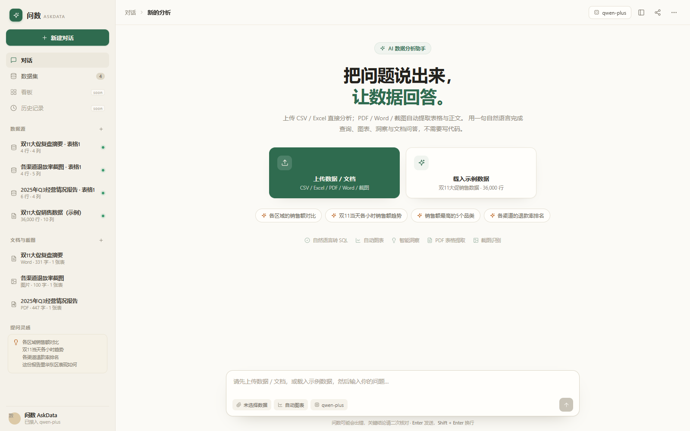

### 3.2 核心能力

- **对话即分析**：一句话完成查询、图表、结论，结果自带可展开 SQL；
- **非结构化数据平权**：PDF / Word / 图片 → 自动提取表格为数据集，复用同一套分析链路；
- **按数据类型自动选图**：识别时间、分类、占比、矩阵、相关性等数据结构，推荐合适的图表；
- **商品图创意可视化**：灰色商品图形做底、颜色在图像内部按占比填充，并带入场动画与下钻；
- **可追溯的 AI**：SQL 可核对、文档回答带引用，降低“AI 胡说”的风险；
- **演示级鲁棒性**：SQL 校验与失败重试、模型超时降级、演示模式、数据源重置与会话保留。

### 3.3 与常见方案的区别

| 环节 | 常见做法 | 本作品做法 |
|---|---|---|
| Text-to-SQL | 直接让大模型写 SQL | 先出分析计划，再生成 SQL，并经静态校验与失败重试 |
| 图表生成 | 让模型直接写 ECharts 配置 | 输出中间层 chart spec；前端按数据画像推荐图表并统一渲染 |
| 图表选择 | 固定柱/线/饼 | 自动推荐 + 推荐理由 + 用户可切换，覆盖商品图、热力、树图、散点 |
| 结论生成 | SQL 与结论一次生成 | 二次调用，强制引用真实查询数字 |
| 数据接入 | 仅 CSV / Excel | CSV / Excel / PDF / Word / 图片 |
| 数据状态 | 切走即丢、只能重传 | 数据源会话缓存 + 一键“重置数据源”重新读取原文件 |
| 可信度 | 黑盒回答 | SQL 检查器 + 文档引用片段 |

---

## 四、系统架构

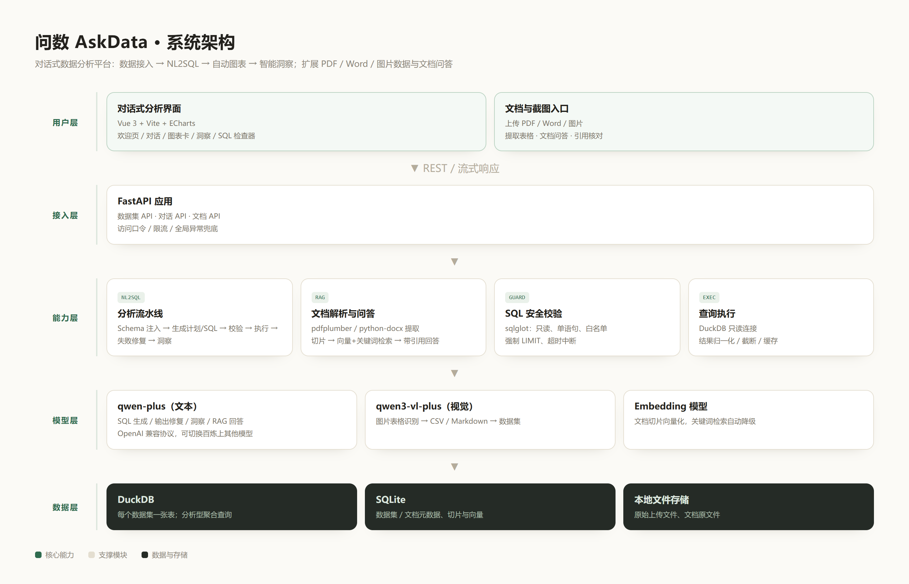

系统分为五层：

- **用户层**：Vue 3 + Vite + ECharts 单页应用，负责对话、图表、检查器、文档问答与图表切换；
- **接入层**：FastAPI 提供数据集、对话、文档三类 API，带访问口令与限流；生产模式同时托管前端静态资源；
- **能力层**：NL2SQL 流水线、SQL 安全校验、DuckDB 执行、图表推荐、洞察生成、文档解析与 RAG；
- **模型层**：通过 OpenAI 兼容协议接入阿里云百炼的 qwen-plus（文本）、qwen3-vl-plus（视觉）与 Embedding 模型，可切换其他模型；
- **数据层**：DuckDB 存分析数据，SQLite 存元数据，本地文件存原始上传文件。

---

## 五、数据接入与元数据

### 5.1 数据支持

- CSV / Excel（xlsx）：自动编码探测（UTF-8 / GBK）、中文表头、类型推断（时间、数值、布尔）、空值与重复提示；
- PDF / Word：提取正文与表格；
- 图片：调用视觉大模型识别表格，输出 CSV / Markdown 后转为 DataFrame。

### 5.2 写入 DuckDB

解析后的 DataFrame 直接注册为 DuckDB 表，每个数据集独立一个 `.duckdb` 文件。选择 DuckDB 的原因：

- 分析型聚合性能好，单机零部署；
- 支持直接读取 CSV，方便扩展；
- 只读连接即可完成安全隔离。

### 5.3 给模型看的 Schema

系统会把每个字段的 **类型、样例值、枚举值、空值率、取值范围** 注入 Prompt。这是 SQL 准确率的关键：模型必须知道“数据长什么样”，才能写出正确的字段名与过滤条件。

```
表名：demo_double11（行数：36,000，列数：10）
- order_time  TIMESTAMP  范围 2025-10-01 00:05:28 ~ 2025-11-12 23:59:33
- region      VARCHAR    枚举=华东/华南/华北/西南/东北/华中
- amount      DOUBLE     范围 33.26 ~ 19800
```

### 5.4 数据源状态管理

- 每个数据源 / 文档的对话保存在前端会话缓存中，切换出去再点回来不会清空；
- 点“新建对话”才清空当前数据源的会话；
- 顶栏“重置数据源”会重新读取原始文件、重建 DuckDB 表，并清空当前数据源会话，避免误用旧数据；
- 重置接口支持示例数据与上传的 CSV / Excel；文档派生数据集提示重新导入。

---

## 六、核心实现一：Text-to-SQL 流水线

### 6.1 总体流程

```
用户问题
  → Schema / 口径 / 历史上下文注入
  → 大模型输出 JSON（intent + plan + sql + chart + assumptions）
  → sqlglot 静态校验（只读、单语句、表白名单、强制 LIMIT）
  → DuckDB 执行
  → 失败则把报错回喂模型修复（最多 2 次）
  → 洞察二次调用（结论 + 依据 + 追问建议）
  → 前端推荐图表并渲染
```

### 6.2 为什么不用 LangChain

比赛周期短，LangChain 的抽象层会增加调试成本。我们选择显式 pipeline：

- 每一步都可独立打日志、定位问题；
- 便于在技术文档中清晰说明“我们做了什么”；
- 不依赖框架版本，部署更轻。

### 6.3 SQL 安全校验

大模型可能生成危险或越权 SQL，因此执行前必须过一层 `sqlglot` 静态校验：

- 只允许单条 `SELECT / WITH`；
- 禁止 `INSERT / UPDATE / DELETE / DROP / ATTACH` 等；
- 表名白名单（仅当前数据集）；
- 强制追加 `LIMIT`；
- 只读 DuckDB 连接 + 查询超时中断。

### 6.4 失败自动修复

真实场景中 SQL 错误大多来自字段名、方言函数、类型不匹配。系统会把数据库原始报错回喂模型：

```
上一条 SQL 执行失败。
错误信息：Binder Error: Referenced column "region_name" not found
原 SQL：...
请修复后只输出 JSON。
```

实测中，复杂问题在第一次失败后可自动修复成功，显著提升端到端成功率。

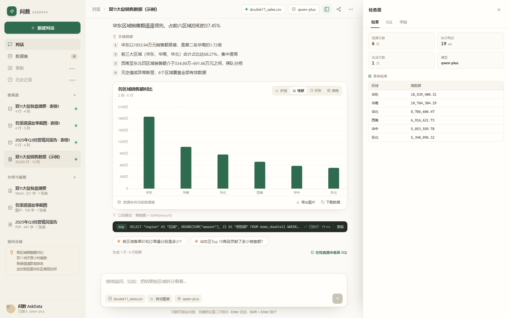

### 6.5 时间口径：以数据为准

Demo 数据是 2025 年，而系统日期是 2026 年。如果直接用 `CURRENT_DATE`，“上个月”“最近 30 天”“双11当天”都会查空。为此我们：

- 在 Schema 中注入每个时间字段的真实 min/max；
- 把 Prompt 中的相对时间改为以 `MAX(时间字段)` 为基准；
- 明确要求“根据数据时间范围推断年份”。

### 6.6 输出容错

大模型偶尔会把数组写成字符串、把 `null` 写成空串。后端增加归一化层，并在修复路径加异常兜底，避免一个 500 毁掉整个演示。

---

## 七、核心实现二：图表推荐与创意可视化

### 7.1 为什么需要“按数据类型自动选图”

同一个结果集可以画成多种图，但只有少数是正确的：

- 时间趋势用柱状会遮住变化趋势；
- 品类构成用散点几乎不可读；
- 两个分类维度 + 一个指标用单柱状图会丢失矩阵关系；
- 低离散值的“数量”字段画散点会变成几条水平线。

因此前端在渲染前先做**数据画像 + 意图判断**，再决定默认图表。

### 7.2 推荐器规则

| 数据特征 / 意图 | 推荐图表 | 理由 |
|---|---|---|
| 存在时间字段 | 折线图 | 趋势变化最直观 |
| 数据点 > 12 且单指标 | 折线图 | 点太多柱状图会拥挤 |
| 两个分类维度 + 一个数值 | 热力图 | 矩阵关系一眼可见 |
| 两个连续数值字段 | 散点图 | 看相关性与离群点 |
| 品类 / 商品构成（4–12 类） | **商品图** | 图像化占比，更有业务画面感 |
| 占比 / 份额 / 构成 | 环形图 | 部分与整体关系 |
| 分类对比（≤12 类） | 柱状图 | 横向比较最清晰 |
| 多指标对比 | 分组柱状图 | 同维度多指标并列 |
| 字段复杂 / 不适合图形化 | 数据明细 | 避免错误图表 |

实现要点：

- 推荐类型**排在切换栏第一位并标注“推荐”**，同时显示推荐理由；
- 其他图表列在后面，用户可自由切换；
- 表格不再占顶部切换位置，收进底部“数据明细”按钮；
- 散点图额外检查数值字段离散程度，避免低离散值造成的“几条水平线”；
- 热力图对同一单元格的多条记录先聚合去重，关闭热力动画并开启标签防重叠。

### 7.3 支持的图表类型

| 类型 | 适用场景 | 视觉增强 |
|---|---|---|
| 柱状 | 分类对比、排名 | 渐变圆角、数值标签、均值线 |
| 折线 | 时间趋势 | 面积渐变、平滑曲线、均值虚线 |
| 环形 | 占比构成 | 中心合计、分类色板、百分比标签 |
| **商品图** | 品类构成 | 灰度商品图形、内部占比填充、入场动画、点击下钻 |
| 热力 | 两个分类维度矩阵 | 色阶、单元格聚合、标签防重叠 |
| 树图 | 层级占比 | 面积映射、百分比标签 |
| 散点 | 两个连续数值 | 相关性、悬停详情 |
| 数据明细 | 复杂字段 | 表头吸顶、单元格数据条、Zebra 行 |

### 7.4 商品图创意可视化

这是本项目在“可视化表达”上的重点创新：不是把数字塞进普通图表，而是让**商品图形本身成为数据载体**。

- 每个品类对应一张**统一风格的商品图形**（手机、沙发、连衣裙、口红、苹果等，Canvas 自绘，不依赖系统 emoji）；
- 商品图形整体渲染为**灰色**作为底；
- 该品类的销售额占比用**浅色**从图形内部底部向上填充，颜色只出现在商品轮廓内部；
- 不同品类不同颜色，颜色低饱和，避免抢走商品本体的注意力；
- 品类名称居中显示在商品图形下方，百分比显示在图形上方；
- 每行最多 4 个，超出按左→右、上→下换行，窄屏自动降为 3 / 2 列；
- 无购物袋、无边框，商品图形就是主体；
- **入场动画**：从中心向外扩散、羽化边缘、透明到不透明，逐项错峰；
- **交互**：悬停放大，点击自动把“查看某品类销售明细”填入输入框，作为下钻入口；
- 百分比数字随填充从 0 涨到实际值。

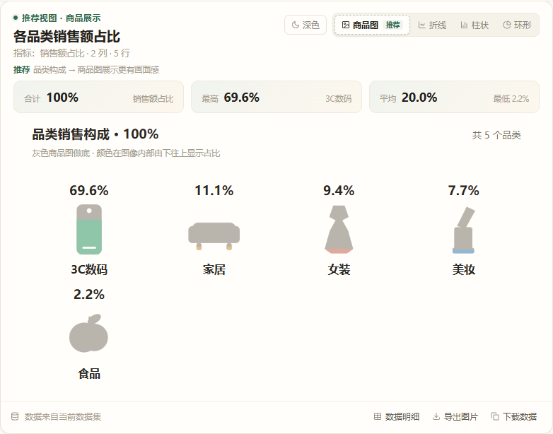

### 7.5 图表的可读性与一致性

- 顶部自动生成 KPI 概览：合计 / 最高 / 平均；比率类指标改为平均 / 最高 / 最低；
- 图表标题、指标说明、推荐理由、图表类型切换集中在卡片头部；
- 支持浅色 / 深色两套主题；
- 图表导出图片时自动带上标题、指标说明与品牌水印；
- 所有数值统一万 / 亿 / 百分比格式，避免“12345678.9”这种难以阅读的数字。

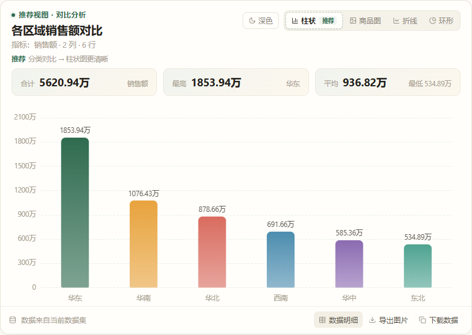

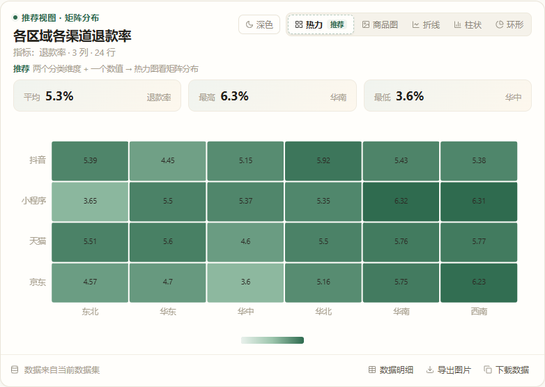

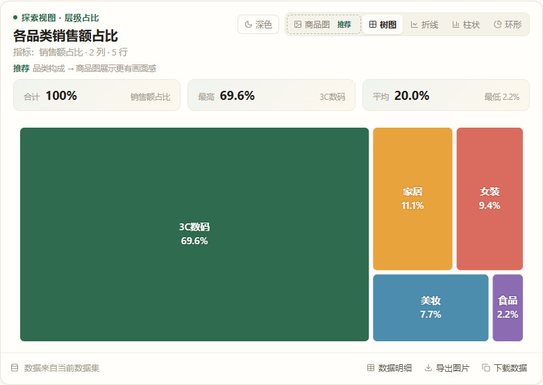

### 7.6 智能洞察

查询成功后，系统二次调用模型，输入是“问题 + SQL + 结果摘要”，要求输出：

- headline：一句话结论；
- bullets：2–4 条带真实数字的依据；
- followups：2 条自然的追问建议。

Prompt 中强制约束：**禁止编造结果中不存在的数字**，金额自动换算万 / 亿，比率保留两位小数。

示例（真实运行结果）：

> 双11当日销售额呈双峰分布，0点峰值达 147.90 万元。
> - 0点销售额达 147.90 万，为全天最高，是最低值（5点 3.14 万）的 47.1 倍；
> - 20点出现第二高峰 48.45 万，较19点增长 14.17%；
> - 凌晨 3–5 点持续低迷，三小时合计仅 14.50 万，占全天不足 1.2%。

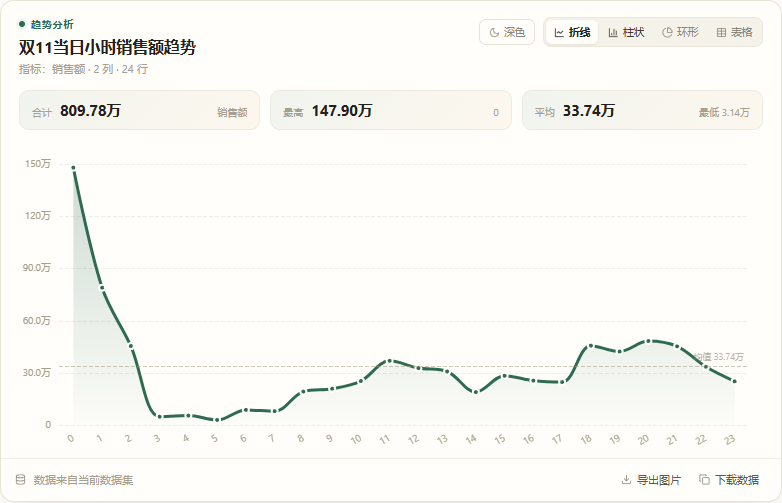

---

## 八、核心实现三：文档、截图数据化与 RAG

### 8.1 表格提取

| 类型 | 解析方式 | 结果 |
|---|---|---|
| PDF | pdfplumber 提取文字与表格 | 表格 → DataFrame → DuckDB 数据集 |
| Word | python-docx 提取段落与表格 | 表格 → DataFrame → DuckDB 数据集 |
| 图片 | qwen3-vl-plus 视觉模型识别 | CSV / Markdown → DataFrame → DuckDB 数据集 |
| 扫描版 PDF | 渲染页面 → 视觉模型 OCR | 文字 + 表格 |

**关键架构决策**：所有来源的表格最终都转成 DataFrame 并注册为数据集，直接复用已有的 NL2SQL、图表、洞察、检查器能力，不需要为文档另写一套分析链路。

### 8.2 文档 RAG

正文按 420 字、80 字重叠切片；上传时调用 Embedding 模型生成向量并存储；提问时用“向量相似度 + 字符 bigram 关键词”混合检索 Top-5 片段，再由大模型生成带引用编号的回答。向量接口不可用时自动降级为关键词检索。

### 8.3 实测效果

| 文件 | 解析结果 | 问答 |
|---|---|---|
| 2025 年 Q3 经营情况报告.pdf | 提取 6×4 区域销售额表格 | 问“华东区 Q3 销售额和同比” → 1,853.94 万元、-11.2%，带 [1] 引用 |
| 双11大促复盘摘要.docx | 提取 4×4 渠道退款率表格 | 问“双11当天销售额及占比” → 809.78 万元、26.4% |
| 各渠道退款率截图.png | 视觉模型识别出 4×4 表格 | 问“哪个渠道退款率最高” → 小程序 5.57% |

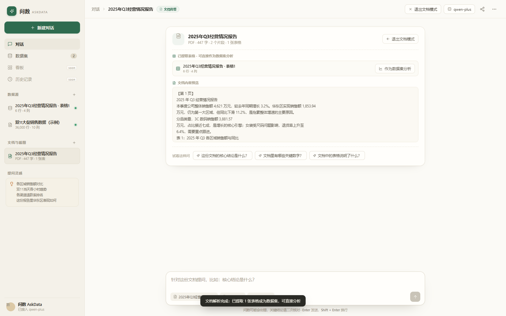

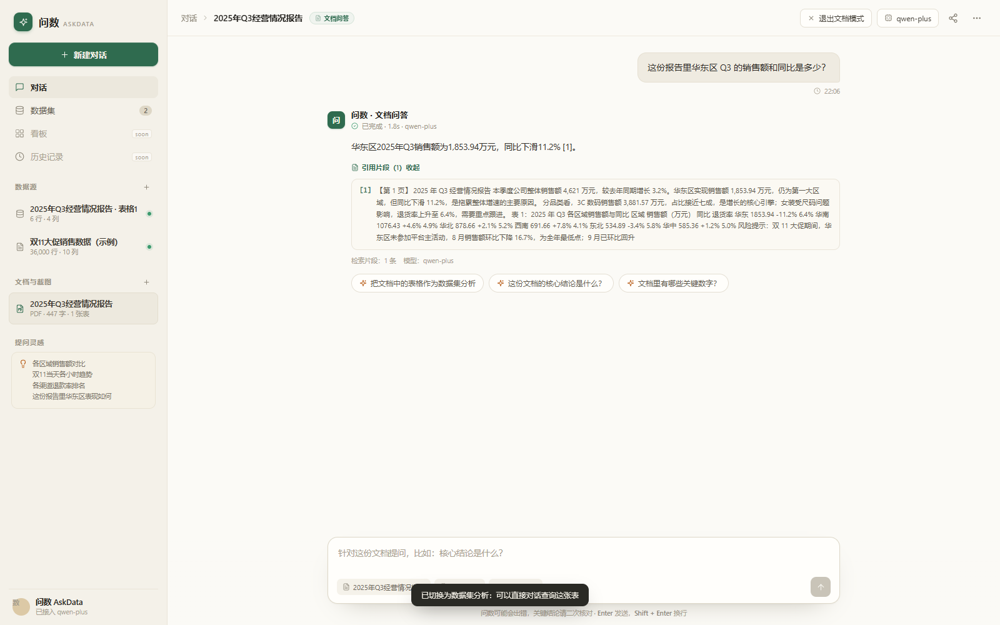

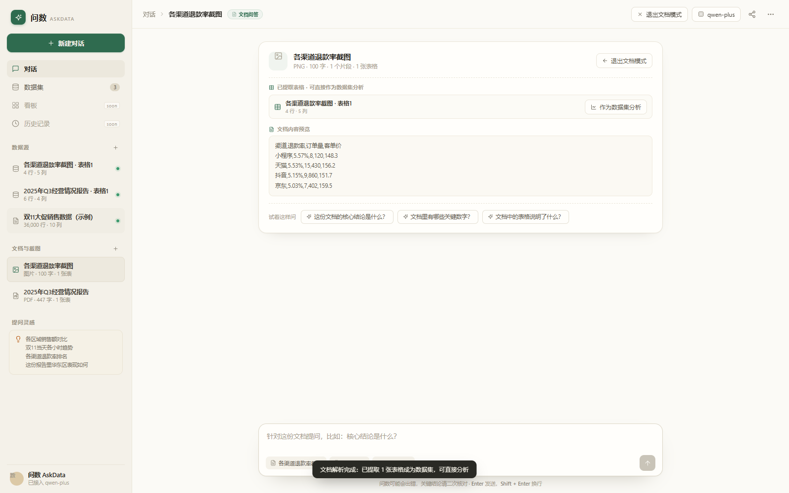

---

## 九、工程化与稳定性

### 9.1 安全与可追溯

1. **密钥安全**：API Key 只存后端 `.env`，已被 `.gitignore` 排除；前端不接触密钥；
2. **SQL 安全**：只读连接 + 静态校验 + 白名单 + LIMIT + 超时；
3. **公网保护**：支持访问口令与每分钟限流，防止演示地址被刷；
4. **失败降级**：模型超时 / 报错时自动回退规则版演示模式，保证现场可演示；
5. **异常兜底**：全局异常处理器保证接口始终返回 JSON；
6. **可解释**：SQL 检查器、文档引用、执行耗时全部可见。

### 9.2 数据源与会话状态

- 按数据源 / 文档缓存对话，切换后回来可继续；
- “新建对话”主动清空当前会话；
- “重置数据源”重新读取原始文件并重建分析表，避免旧数据污染；
- 重置支持示例数据与上传数据，接口为 `POST /api/datasets/{id}/reset`。

### 9.3 多端交付

- **GitHub 一键环境**：仓库内置 `.devcontainer`，点 Codespaces 徽章即可在云端安装依赖、构建前端并启动 8000 端口；
- **考官一键启动包**：双击 `启动演示.bat`，自动创建 venv、安装依赖（清华镜像）、读取模型 Key、启动服务并打开浏览器；
- **Docker / Render**：提供 `Dockerfile`、`docker-compose.yml`、`render.yaml`，单容器单端口部署；
- **真机模拟**：在独立目录从零安装验证，发现并修复默认 PyPI 卡顿、requirements 缺依赖等问题。

---

## 十、测试与评测

### 10.1 真实模型评测（36,000 行双11数据）

| 问题 | 结果 | 耗时 |
|---|---|---|
| 各区域的销售额对比 | ✅ 正确 SQL + 中文洞察 | 8.9s |
| 2025年双11当天各小时销售额趋势 | ✅ 正确日期过滤 + 双峰洞察 | 12.2s |
| 销售额最低的3个品类 | ✅ 升序 + “最低”洞察 | 7.8s |
| 各渠道的退款率排名 | ✅ CASE WHEN 比率计算 | 9.3s |
| 最近30天的销售额趋势 | ✅ 以数据最大日期为基准 | 12.5s |
| 华东地区销售额最高的3个城市 | ✅ 自动修复后成功 | 12.5s |

### 10.2 可视化与交互验证

- **推荐器**：区域对比 → 柱状；品类占比 → 商品图；区域 × 渠道 → 热力图；连续双数值 → 散点（低离散值自动不推荐）；
- **图表修复**：热力图同一单元格聚合去重、关闭动画、标签防重叠；退款率 KPI 改为平均 / 最高 / 最低，不再误显示“合计 100%”；
- **商品图**：灰度图形 + 图像内部占比、4 列布局、窄屏自适应、入场动画、悬停放大、点击填入下钻问题；
- **路由与状态**：切换数据源再返回，消息节点数保持 2 → 2；点“重置数据源”后提示重新读取成功。

### 10.3 工程与安装验证

- 干净环境安装：43 个 Python 发行包、约 270MB，首次安装约 2 分钟；启动后真实模型、前端页面、示例数据均正常；
- 重置接口：示例数据与上传 CSV 均验证通过；
- 前端 E2E：真实浏览器点击完成“上传 → 提问 → 图表 → 检查器 → 文档问答”，无浏览器报错；
- 演示视频：6 分 06 秒、1920×1080、8fps、配音 + 烧录字幕。

### 10.4 模型选型评测

| 模型 | 单问耗时 | 结论 |
|---|---|---|
| qwen3.8-max-0902 | 30–90s | 质量高但现场演示过慢 |
| **qwen-plus（采用）** | **8–12s** | 质量与速度平衡最好 |
| glm-5.2-fast-preview | 4–6s | 最快，复杂问题质量略降 |
| qwen3.8-flash | 12–53s | 波动大，不采用 |

---

## 十一、部署与运行

### 11.1 本地运行

```powershell
powershell -ExecutionPolicy Bypass -File scripts\setup.ps1   # 安装依赖 + 生成演示数据
powershell -ExecutionPolicy Bypass -File scripts\dev.ps1     # 启动前后端
# 访问 http://127.0.0.1:5173（开发）或 http://127.0.0.1:8000（生产单端口）
```

### 11.2 考官一键启动包

解压后双击 `启动演示.bat`，脚本会自动：

1. 检查 Python；
2. 创建虚拟环境并安装后端依赖（清华镜像优先）；
3. 从 `judge/backend.env` 读取模型 Key（没有则自动演示模式）；
4. 复用已构建的前端 `dist`；
5. 启动 8000 端口并打开浏览器。

### 11.3 Docker / 云平台

```bash
docker compose up -d --build
# 访问 http://服务器IP:8000
```

仓库同时提供 `render.yaml`，可在 Render 上一键部署；`APP_ACCESS_CODE` 可设置访问口令，`RATE_LIMIT_PER_MIN` 可限流。

### 11.4 GitHub Codespaces

仓库内置 `.devcontainer`，点击 README 的 “Open in GitHub Codespaces” 徽章即可：

- 自动安装 Python 依赖、构建前端、启动 8000 端口；
- 未配置 Key 时自动进入演示模式；
- 在仓库 Secrets 中配置 `LLM_API_KEY` 即可使用真实模型。

---

## 十二、局限与演进规划

### 12.1 当前局限

- 以单表分析为主，多表 JOIN 仍需用户明确表关系；
- 准确率依赖模型与数据质量，复杂口径问题需要更多示例；
- 上传限制 30MB，大文件需先抽样；
- 商品图为自绘矢量图形，尚未接入真实商品照片素材；
- 图表推荐以规则引擎为主，复杂业务意图仍需要大模型参与判断；
- 公网部署与多用户权限尚未完善。

### 12.2 演进路线

1. **语义层与口径配置**：把指标口径固化，减少模型自由发挥；
2. **多表关系与 JOIN**：自动识别表间关系，支持跨表分析；
3. **真实商品图**：支持透明 PNG / SVG 商品素材，自动灰度与内部占比；
4. **图表推荐 2.0**：引入大模型判断业务意图，结合规则生成更准确的推荐理由；
5. **看板与分享**：把分析卡片固定为看板，支持团队协作；
6. **评测体系**：建立 50+ 题的 Text-to-SQL 与可视化评测集，量化准确率与修复率。

---

## 十三、团队分工

| 成员 | 分工 |
|---|---|
| 罗勇添 | 项目统筹、后端架构、NL2SQL 链路、模型接入与调优 |
| 辛嘉炜 | 前端开发、图表与交互、E2E 测试与演示脚本 |
| 林俊宁 | 文档解析与 RAG、测试数据、技术文档与演示视频 |
| 指导老师 林龙键 | 选题指导、方案评审、比赛材料把关 |

---

## 附录 A：NL2SQL Prompt（节选）

```text
# 角色
你是「问数 AskData」的资深数据分析师 & Text-to-SQL 引擎。
任务：把用户问题翻译成 1 条可在 DuckDB 执行的 SELECT，并给出分析意图。

# 环境
- 数据实际时间范围：{DATA_TIME_RANGE}
- 只允许单条 SELECT/WITH，必须包含 LIMIT {MAX_ROWS}

# 数据表结构
{SCHEMA_BLOCK}

# 输出格式（只输出 JSON）
{"intent":"query","plan":"...","sql":"...",
 "chart":{"type":"line|bar|pie|scatter|table","x":"...","y":["..."]},
 "assumptions":[],"clarification":null}

# 规则
1. 只能使用真实存在的表与字段，中文标识符用双引号；
2. 所有输出列使用中文业务别名，chart.x / chart.y 与结果列一致；
3. 时间口径以数据实际范围为准，“上个月/最近N天”用 MAX(时间字段) 为基准；
4. 图表类型只是建议，前端会根据数据画像与意图重新推荐；
5. 无法回答时返回 intent=clarify 并给出 2–3 个澄清选项。
```

## 附录 B：主要 API

| 方法 | 路径 | 说明 |
|---|---|---|
| POST | /api/datasets/upload | 上传 CSV / Excel |
| POST | /api/datasets/demo | 载入示例数据 |
| GET | /api/datasets | 数据集列表 |
| POST | /api/datasets/{id}/reset | 重置数据源（重新读取原始文件） |
| POST | /api/chat | 自然语言分析 |
| POST | /api/query | 检查器执行 SQL |
| POST | /api/documents/upload | 上传 PDF / Word / 图片 |
| POST | /api/documents/{id}/ask | 文档 RAG 问答 |
| GET | /api/health | 服务与模型状态 |

---

*本技术文档由项目组编写，截图与数据均来自系统真实运行结果。*
