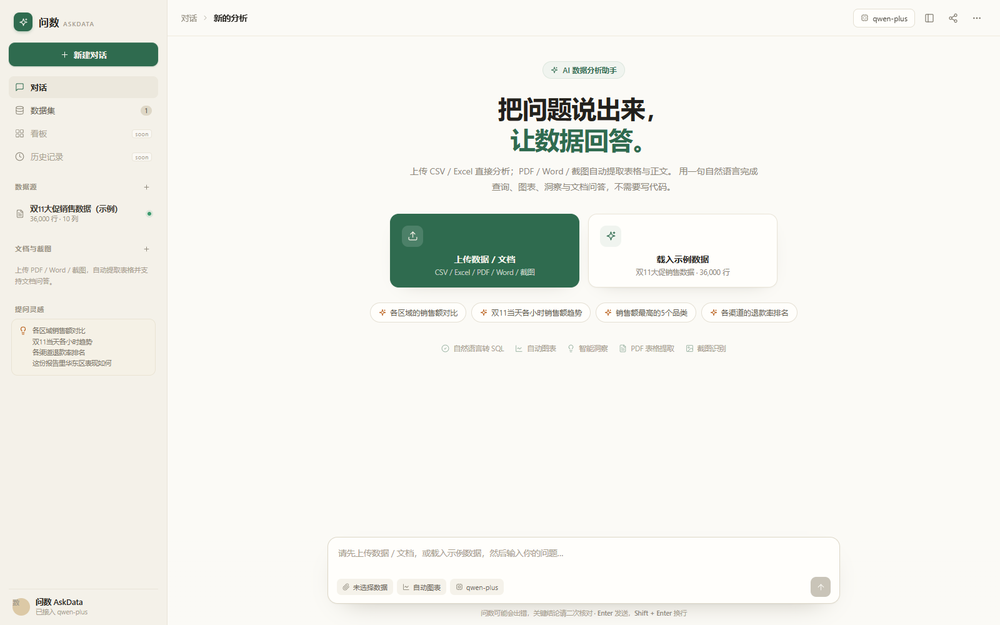
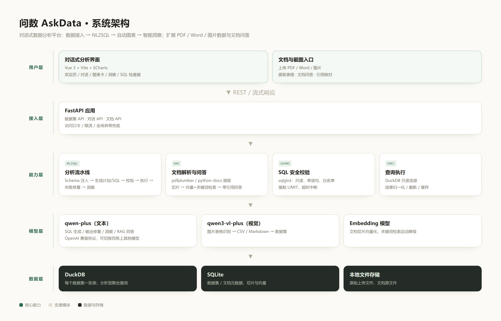
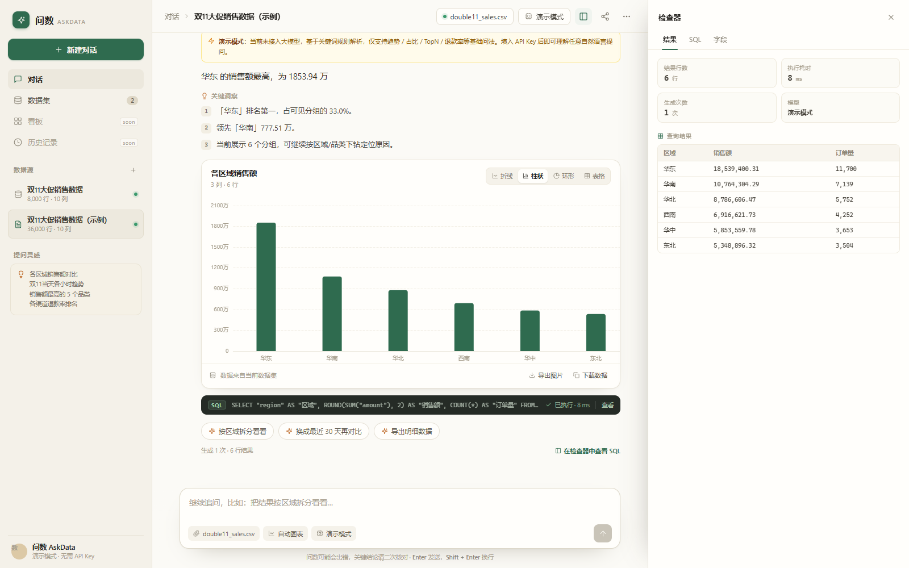
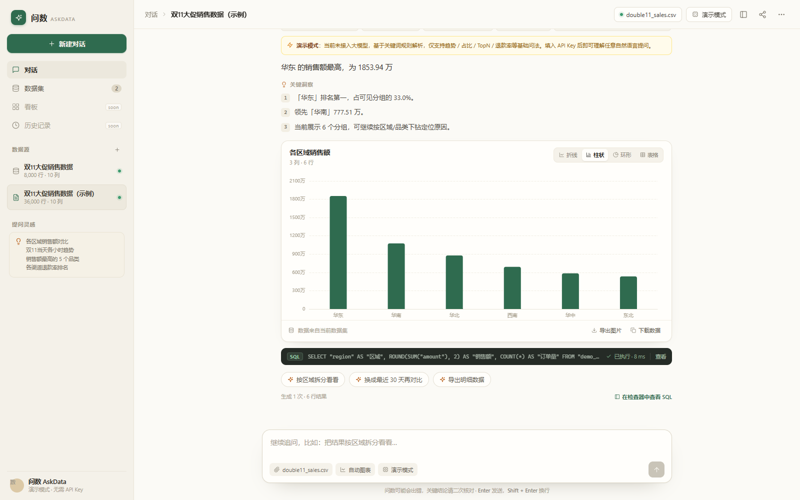
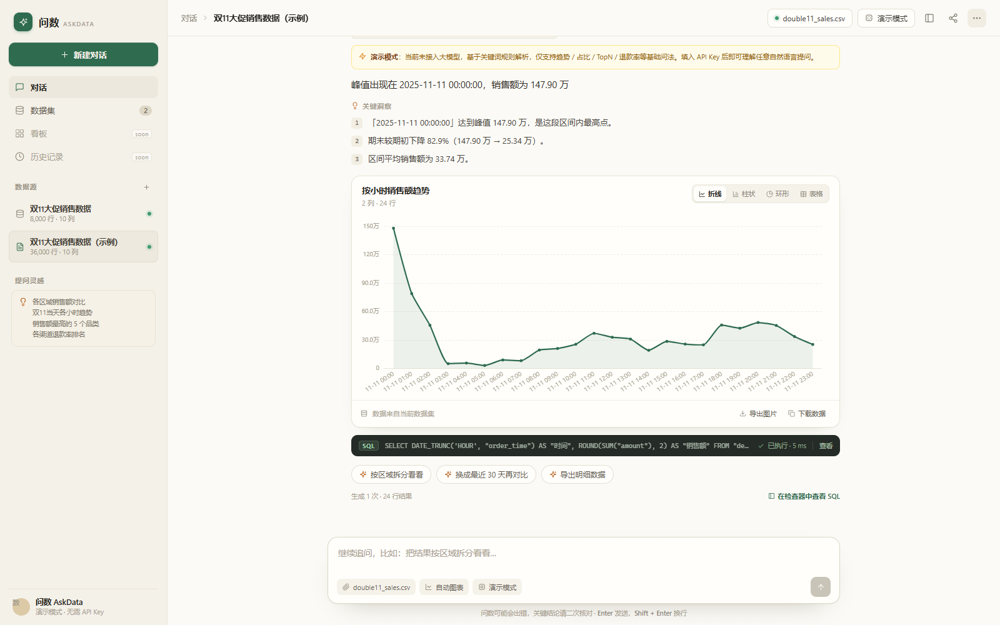
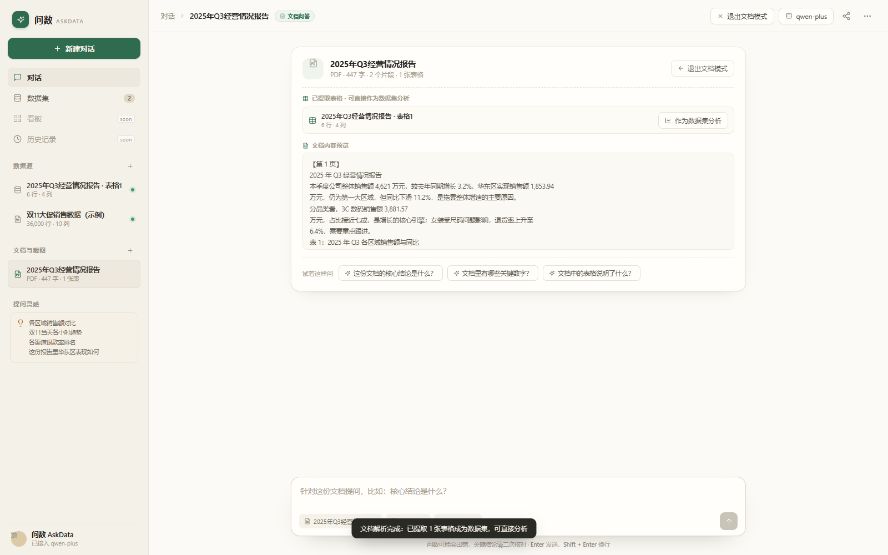
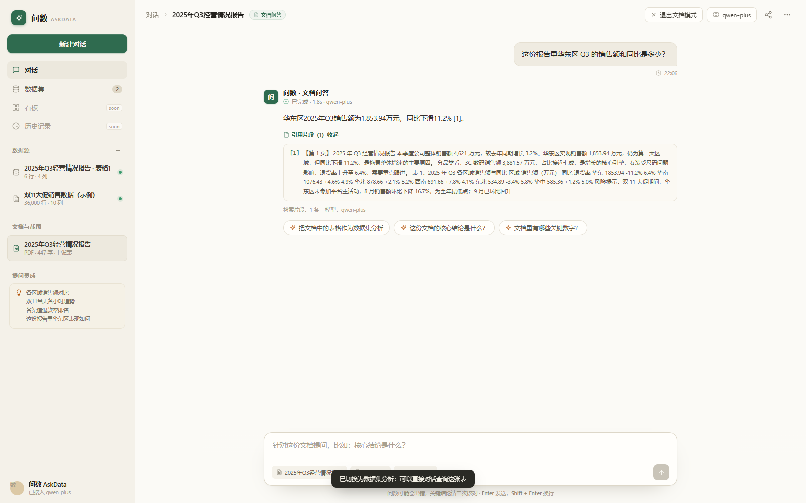
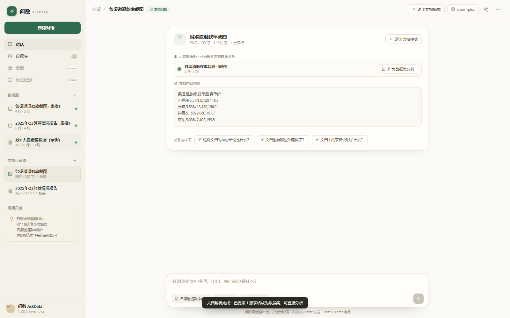

# 问数 AskData — 基于自然语言交互的数据分析平台

**赛道二：AI WEB 网页开发挑战赛 · 技术文档**

学校：广东科贸职业学院  
指导老师：林龙键  
团队成员：罗勇添、辛嘉炜、林俊宁  
提交日期：2026 年 10 月

---

## 摘要

问数 AskData 是一个面向业务人员的对话式数据分析平台。用户只需上传数据或文档，用自然语言提问，系统即可自动完成 **自然语言转 SQL（NL2SQL）→ 查询执行 → 自动图表 → 智能洞察 → 多轮追问**，并支持把 PDF 财报、Word 报告、图片截图中的表格提取为可分析数据集、对文档正文进行带引用的 RAG 问答。

针对“业务同学不会写 SQL、取数排队、非结构化数据无法分析”三类现实问题，本作品把“从数据到结论”的链路压缩成一次对话，并保证每个结论都能展开 SQL 与引用片段进行核对。

实测结果：在 36,000 行双11销售数据上，6 类典型问题全部生成正确 SQL 与图表，单问耗时 8–12 秒；多轮追问可继承上下文；模糊问题会主动澄清；SQL 报错可自动修复；PDF / Word / 图片表格均能解析为数据集并完成文档问答。

---

## 一、背景与痛点：我们要解决的方向

### 1.1 工具门槛：会查数据的人太少

企业里真正会写 SQL 的人集中在数据团队，而需要看数据的人遍布运营、市场、销售、财务。一次取数需要“提需求 → 排队 → 等报表”，周期常常以天计，业务决策被迫滞后。

### 1.2 流程门槛：分析链路被切断

传统 BI 工具要求用户先理解维度、度量、聚合、过滤等概念，再拖拽配置图表。业务人员往往“知道自己想问什么”，但不知道怎么把它翻译成工具操作，分析链路在第一步就中断。

### 1.3 数据形态门槛：大量数据不在数据库里

企业里很多关键数据并不在规整的 Excel 或数据库里，而是躺在 **PDF 财报、Word 报告、聊天截图** 中。传统工具无法读取这些内容，导致“看得见、分析不了”。

### 1.4 方向判断

因此，本项目要解决的不是“再做一个 BI 图表工具”，而是：

> **让任何人都能用自然语言直接获得可信、可追溯的数据结论，并把散落在文档与图片里的数据变成可分析资产。**

---

## 二、目标用户与典型场景

| 用户 | 痛点 | 使用方式 |
|---|---|---|
| 运营 / 市场人员 | 不会 SQL，取数依赖分析师 | 上传活动数据，直接问“各渠道退款率排名” |
| 数据分析师 | 重复取数占用大量时间 | 用对话快速出初版 SQL 与图表，再在检查器中核对 |
| 管理者 / 财务 | 看 PDF 财报，无法快速定位数字 | 上传财报，问“华东区 Q3 销售额和同比” |
| 学生 / 研究者 | 数据在 Excel、截图里 | 上传文件即分析，无需搭环境 |

典型场景：大促复盘、月度经营分析、财报关键指标提取、运营异常归因、课程作业数据分析。

---

## 三、方案总览与创新点

### 3.1 产品形态

左侧为数据源与文档列表，中间为对话流，右侧为检查器（结果表 / SQL / 字段结构）。所有分析结果以“卡片”形式呈现：结论、图表、洞察、SQL、追问建议。



### 3.2 四个创新点

1. **对话即分析**：一句话完成查询、图表、结论，结果自带可展开 SQL；
2. **非结构化数据平权**：PDF / Word / 图片 → 自动提取表格为数据集，复用同一套分析链路；
3. **可追溯的 AI**：SQL 可核对、文档回答带引用，降低“AI 胡说”的风险；
4. **演示级鲁棒性**：SQL 校验与失败重试、模型超时降级、无 Key 演示模式，保证现场稳定。

### 3.3 与常见方案的区别

| 环节 | 常见做法 | 本作品做法 |
|---|---|---|
| Text-to-SQL | 直接让大模型写 SQL | 先出分析计划，再生成 SQL，并经静态校验与失败重试 |
| 图表生成 | 让模型直接写 ECharts 配置 | 输出中间层 chart spec，前端统一渲染并可切换图表类型 |
| 结论生成 | SQL 与结论一次生成 | 二次调用，强制引用真实查询数字 |
| 数据接入 | 仅 CSV / Excel | CSV / Excel / PDF / Word / 图片 |
| 可信度 | 黑盒回答 | SQL 检查器 + 文档引用片段 |

---

## 四、系统架构



系统分为五层：

- **用户层**：Vue 3 + Vite + ECharts 单页应用，负责对话、图表、检查器与文档问答；
- **接入层**：FastAPI 提供数据集、对话、文档三类 API，带 CORS、访问口令与限流；生产模式同时托管前端静态资源；
- **能力层**：NL2SQL 流水线、SQL 安全校验、DuckDB 执行、洞察生成、文档解析与 RAG；
- **模型层**：通过 OpenAI 兼容协议接入阿里云百炼的 qwen-plus（文本）、qwen3-vl-plus（视觉）与 Embedding 模型，可一键切换其他厂商；
- **数据层**：DuckDB 存分析数据，SQLite 存元数据，本地文件存原始上传文件。

---

## 五、数据接入与元数据

### 5.1 数据支持

- CSV / Excel（xlsx）：自动编码探测（UTF-8 / GBK）、中文表头、类型推断（时间、数值、布尔）、空值与重复提示；
- PDF / Word：提取正文与表格；
- 图片：调用视觉大模型识别表格，输出 CSV / Markdown 后转为 DataFrame。

### 5.2 写入 DuckDB

解析后的 DataFrame 直接注册为 DuckDB 表，每个数据集独立一个 `.duckdb` 文件。选择 DuckDB 的原因：

- 分析型聚合性能好，单机零部署；
- 支持直接读取 CSV，方便扩展；
- 只读连接即可完成安全隔离。

### 5.3 给模型看的 Schema

系统会把每个字段的 **类型、样例值、枚举值、空值率、取值范围** 注入 Prompt。这是 SQL 准确率的关键：模型必须知道“数据长什么样”，才能写出正确的字段名与过滤条件。

```
表名：demo_double11（行数：36,000，列数：10）
- order_time  TIMESTAMP  范围 2025-10-01 00:05:28 ~ 2025-11-12 23:59:33
- region      VARCHAR    枚举=华东/华南/华北/西南/东北/华中
- amount      DOUBLE     范围 33.26 ~ 19800
```

---

## 六、核心实现一：Text-to-SQL 流水线

### 6.1 总体流程

```
用户问题
  → Schema / 口径 / 历史上下文注入
  → 大模型输出 JSON（intent + plan + sql + chart + assumptions）
  → sqlglot 静态校验（只读、单语句、表白名单、强制 LIMIT）
  → DuckDB 执行
  → 失败则把报错回喂模型修复（最多 2 次）
  → 洞察二次调用（结论 + 依据 + 追问建议）
  → 前端渲染图表、SQL、洞察
```

### 6.2 为什么不用 LangChain

比赛周期只有 4 天，LangChain 的抽象层会增加调试成本。我们选择约 200 行的显式 pipeline：

- 每一步都可独立打日志、定位问题；
- 便于在技术文档中清晰说明“我们做了什么”；
- 不依赖框架版本，部署更轻。

### 6.3 SQL 安全校验

大模型可能生成危险或越权 SQL，因此执行前必须过一层 `sqlglot` 静态校验：

- 只允许单条 `SELECT / WITH`；
- 禁止 `INSERT / UPDATE / DELETE / DROP / ATTACH` 等；
- 表名白名单（仅当前数据集）；
- 强制追加 `LIMIT`；
- 只读 DuckDB 连接 + 查询超时中断。

### 6.4 失败自动修复

真实场景中 SQL 错误大多来自字段名、方言函数、类型不匹配。系统会把数据库原始报错回喂模型：

```
上一条 SQL 执行失败。
错误信息：Binder Error: Referenced column "region_name" not found
原 SQL：...
请修复后只输出 JSON。
```

实测中，复杂问题在第一次失败后可自动修复成功，显著提升端到端成功率。



### 6.5 时间口径：以数据为准

Demo 数据是 2025 年，而系统日期是 2026 年。如果直接用 `CURRENT_DATE`，“上个月”“最近 30 天”“双11当天”都会查空。为此我们：

- 在 Schema 中注入每个时间字段的真实 min/max；
- 把 Prompt 中的相对时间改为以 `MAX(时间字段)` 为基准；
- 明确要求“根据数据时间范围推断年份”。

这是本项目最重要的“踩坑—修复”之一。

### 6.6 输出容错

大模型偶尔会把数组写成字符串、把 `null` 写成空串。后端增加归一化层，并在修复路径加异常兜底，避免一个 500 毁掉整个演示。

---

## 七、核心实现二：自动可视化与智能洞察

### 7.1 图表契约

大模型不直接生成 ECharts 配置，而是输出中间层 JSON：

```json
{
  "type": "line",
  "title": "双11当天各小时销售额趋势",
  "x": "小时",
  "y": ["销售额"],
  "sort": "x"
}
```

前端 `ChartCard` 统一渲染，并支持手动切换折线 / 柱状 / 环形 / 表格，支持导出图片与 CSV。这样既保证了模型输出的稳定性，也保留了用户的控制权。

### 7.2 智能洞察

查询成功后，系统二次调用模型，输入是“问题 + SQL + 结果摘要”，要求输出：

- headline：一句话结论；
- bullets：2–4 条带真实数字的依据；
- followups：2 条自然的追问建议。

Prompt 中强制约束：**禁止编造结果中不存在的数字**，金额自动换算万 / 亿，比率保留两位小数。

示例（真实运行结果）：

> 双11当日销售额呈双峰分布，0点峰值达 147.90 万元。
> - 0点销售额达 147.90 万，为全天最高，是最低值（5点 3.14 万）的 47.1 倍；
> - 20点出现第二高峰 48.45 万，较19点增长 14.17%；
> - 凌晨 3–5 点持续低迷，三小时合计仅 14.50 万，占全天不足 1.2%。





---

## 八、核心实现三：文档、截图数据化与 RAG

### 8.1 表格提取

| 类型 | 解析方式 | 结果 |
|---|---|---|
| PDF | pdfplumber 提取文字与表格 | 表格 → DataFrame → DuckDB 数据集 |
| Word | python-docx 提取段落与表格 | 表格 → DataFrame → DuckDB 数据集 |
| 图片 | qwen3-vl-plus 视觉模型识别 | CSV / Markdown → DataFrame → DuckDB 数据集 |
| 扫描版 PDF | 渲染页面 → 视觉模型 OCR | 文字 + 表格 |

**关键架构决策**：所有来源的表格最终都转成 DataFrame 并注册为数据集，直接复用已有的 NL2SQL、图表、洞察、检查器能力，不需要为文档另写一套分析链路。

### 8.2 文档 RAG

正文按 420 字、80 字重叠切片；上传时调用 Embedding 模型生成向量并存储；提问时用“向量相似度 + 字符 bigram 关键词”混合检索 Top-5 片段，再由大模型生成带引用编号的回答。向量接口不可用时自动降级为关键词检索。

### 8.3 实测效果

| 文件 | 解析结果 | 问答 |
|---|---|---|
| 2025 年 Q3 经营情况报告.pdf | 提取 6×4 区域销售额表格 | 问“华东区 Q3 销售额和同比” → 1,853.94 万元、-11.2%，带 [1] 引用 |
| 双11大促复盘摘要.docx | 提取 4×4 渠道退款率表格 | 问“双11当天销售额及占比” → 809.78 万元、26.4% |
| 各渠道退款率截图.png | 视觉模型识别出 4×4 表格 | 问“哪个渠道退款率最高” → 小程序 5.57% |







---

## 九、安全与工程化

1. **密钥安全**：API Key 只存后端 `.env`，已被 `.gitignore` 排除；前端不接触密钥；
2. **SQL 安全**：只读连接 + 静态校验 + 白名单 + LIMIT + 超时；
3. **公网保护**：支持访问口令与每分钟限流，防止演示地址被刷；
4. **失败降级**：模型超时 / 报错时自动回退规则版演示模式，保证现场可演示；
5. **异常兜底**：全局异常处理器保证接口始终返回 JSON，而不是空响应；
6. **可解释**：SQL 检查器、文档引用、执行耗时全部可见。

---

## 十、测试与评测

### 10.1 真实模型评测（36,000 行双11数据）

| 问题 | 结果 | 耗时 |
|---|---|---|
| 各区域的销售额对比 | ✅ 正确 SQL + 中文洞察 | 8.9s |
| 2025年双11当天各小时销售额趋势 | ✅ 正确日期过滤 + 双峰洞察 | 12.2s |
| 销售额最低的3个品类 | ✅ 升序 + “最低”洞察 | 7.8s |
| 各渠道的退款率排名 | ✅ CASE WHEN 比率计算 | 9.3s |
| 最近30天的销售额趋势 | ✅ 以数据最大日期为基准 | 12.5s |
| 华东地区销售额最高的3个城市 | ✅ 自动修复后成功 | 12.5s |

### 10.2 能力验证

- 多轮追问：先问“双11各小时趋势”，再问“那华东呢？”→ 正确继承时间口径并加区域过滤；
- 澄清反问：“最近卖得怎么样” → 主动追问时间范围（7天/30天/本月）；
- 自动修复：复杂问题首次 SQL 失败后，回喂报错重写成功；
- 文档解析：PDF / Word / 图片三类素材全部通过；
- 前端 E2E：真实浏览器点击完成“上传 → 提问 → 图表 → 检查器 → Excel 上传 → 文档问答”，无报错。

### 10.3 模型选型评测

| 模型 | 单问耗时 | 结论 |
|---|---|---|
| qwen3.8-max-0902 | 30–90s | 质量高但现场演示过慢 |
| **qwen-plus（采用）** | **8–12s** | 质量与速度平衡最好 |
| glm-5.2-fast-preview | 4–6s | 最快，复杂问题质量略降 |
| qwen3.8-flash | 12–53s | 波动大，不采用 |

---

## 十一、部署与运行

### 11.1 本地运行

```powershell
pwsh -ExecutionPolicy Bypass -File scripts\setup.ps1   # 安装依赖 + 生成演示数据
pwsh -ExecutionPolicy Bypass -File scripts\dev.ps1     # 启动前后端
# 访问 http://127.0.0.1:5173（开发）或 http://127.0.0.1:8000（生产单端口）
```

### 11.2 Docker 部署

仓库提供 `Dockerfile`、`docker-compose.yml`、`render.yaml`：

```bash
docker compose up -d --build
# 访问 http://服务器IP:8000
```

单容器内完成前端构建 + 后端运行，`backend/.env` 提供模型 Key，数据目录挂载持久化。

### 11.3 在线演示

演示视频中展示本地运行效果；如部署到云服务器，可通过 `APP_ACCESS_CODE` 设置访问口令，防止模型额度被滥用。

---

## 十二、局限与演进规划

### 12.1 当前局限

- 以单表分析为主，多表 JOIN 仍需用户明确表关系；
- 准确率依赖模型与数据质量，复杂口径问题需要更多示例；
- 上传限制 30MB，大文件需先抽样；
- 公网部署与多用户权限尚未完善；
- PDF 复杂版式表格的还原度仍有提升空间。

### 12.2 演进路线

1. **语义层与口径配置**：把指标口径固化，减少模型自由发挥；
2. **多表关系与 JOIN**：自动识别表间关系，支持跨表分析；
3. **看板与分享**：把分析卡片固定为看板，支持团队协作；
4. **更多数据源**：MySQL / PostgreSQL / 飞书表格 / 企业微信文档；
5. **评测体系**：建立 50+ 题的 Text-to-SQL 评测集，量化准确率与修复率。

---

## 十三、团队分工

| 成员 | 分工 |
|---|---|
| 罗勇添 | 项目统筹、后端架构、NL2SQL 链路、模型接入与调优 |
| 辛嘉炜 | 前端开发、图表与交互、E2E 测试与演示脚本 |
| 林俊宁 | 文档解析与 RAG、测试数据、技术文档与演示视频 |
| 指导老师 林龙键 | 选题指导、方案评审、比赛材料把关 |

---

## 附录 A：NL2SQL Prompt（节选）

```text
# 角色
你是「问数 AskData」的资深数据分析师 & Text-to-SQL 引擎。
任务：把用户问题翻译成 1 条可在 DuckDB 执行的 SELECT，并指定图表类型。

# 环境
- 数据实际时间范围：{DATA_TIME_RANGE}
- 只允许单条 SELECT/WITH，必须包含 LIMIT {MAX_ROWS}

# 数据表结构
{SCHEMA_BLOCK}

# 输出格式（只输出 JSON）
{"intent":"query","plan":"...","sql":"...",
 "chart":{"type":"line|bar|pie|scatter|table","x":"...","y":["..."]},
 "assumptions":[],"clarification":null}

# 规则
1. 只能使用真实存在的表与字段，中文标识符用双引号；
2. 所有输出列使用中文业务别名，chart.x / chart.y 与结果列一致；
3. 时间口径以数据实际范围为准，“上个月/最近N天”用 MAX(时间字段) 为基准；
4. 无法回答时返回 intent=clarify 并给出 2–3 个澄清选项。
```

## 附录 B：主要 API

| 方法 | 路径 | 说明 |
|---|---|---|
| POST | /api/datasets/upload | 上传 CSV / Excel |
| POST | /api/datasets/demo | 载入示例数据 |
| GET | /api/datasets | 数据集列表 |
| POST | /api/chat | 自然语言分析 |
| POST | /api/query | 检查器执行 SQL |
| POST | /api/documents/upload | 上传 PDF / Word / 图片 |
| POST | /api/documents/{id}/ask | 文档 RAG 问答 |
| GET | /api/health | 服务与模型状态 |

---

*本技术文档由项目组编写，截图与数据均来自系统真实运行结果。*
